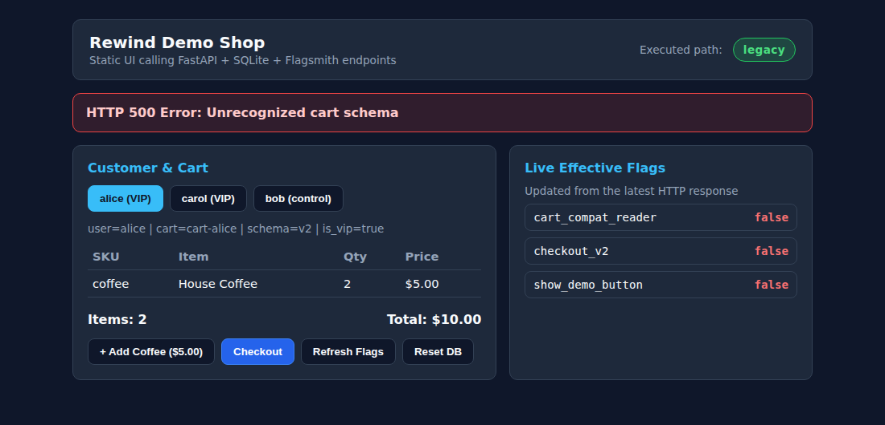

# Rewind

**An AI agent that helps developers roll back a feature flag without breaking their users. It rehearses the rollback in an isolated environment, finds why it fails, proves a fix, and applies it only after the developer approves.**

Off is not undo.

TODO: [Demo video](VIDEO LINK) | [Captured browser replay](https://kittu181707.github.io/rewind/) | [](https://codespaces.new/kittu181707/rewind?quickstart=1)


## The problem

Turning a flag off is supposed to be the safe move, but it can still hurt customers. I reproduced two failures in a demo shop: (a) the old version cannot read data the new one saved, so VIP carts get HTTP 500 after rollback; (b) a targeting override keeps some users on the new version even though the default is OFF, with no error. Flagsmith's own guides ([rollback strategy](https://www.flagsmith.com/blog/rollback-strategy) and [automatic rollback](https://www.flagsmith.com/blog/automatic-rollback)) recommend rehearsing rollbacks in staging, and I wanted a tool that does that rehearsal before touching staging.



## What Rewind does

You type `"roll back checkout_v2"`; Rewind rehearses the rollback in the rehearsal environment, finds what broke, tests up to three fixes that can only change Flagsmith settings, proves a fix with a fixed checker the AI cannot edit (every test user runs the old checkout, finishes checkout and keeps their latest cart), shows the exact changes and applies them to staging only after approval. If no fix passes it says so and changes nothing.

1. With your first approval, Rewind saves test user carts on the new path and switches the feature flag off in rehearsal.
2. If checkout fails or users stay on the new path, the agent reads allowlisted source files and Flagsmith settings.
3. The agent proposes one configuration-only fix from an allowlisted set of flags, scopes and operations.
4. The fixed verifier checks every configured user after three matching Flagsmith reads, rejecting fixes that leave any user broken.
5. With your second approval on the exact operations and starting snapshot, Rewind reproduces the failure on staging, applies the fix and verifies again.

## How it works

```text
request -> [Gate 1: approve rehearsal] -> rehearsal fail -> AI diagnosis (<= 3 tries) -> fixed verifier -> [Gate 2: approve staging plan + drift check] -> staging verified
```

| Rewind does alone | Rewind asks you |
| --- | --- |
| Reads allowlisted source, Flagsmith state and test results | Gate 1: approve running the rehearsal |
| Rehearses rollback and tests up to 3 Flagsmith setting fixes | Gate 2: approve the exact staging operations and snapshot |

The AI reads source, flag state and test results, and proposes a change from an allowed list; it cannot edit code, carts, users or the checker.

## How Rewind uses Flagsmith

| Flagsmith feature | Role in Rewind |
| --- | --- |
| Environments | Separates rehearsal experiments from staging (`demo-target`) using distinct SDK keys. |
| Remote identity eval & traits | Checks per-user effective flags without local SDK cache delays or trait edits. |
| Defaults & segment overrides | Tests compatibility defaults and removes group overrides that block rollbacks. |
| CLI & audit log | Reads snapshots and applies approved changes. |

I used the Flagsmith CLI instead of the MCP server because every write is an allowlisted argument list run without a shell. See [docs/how-rewind-uses-flagsmith.md](docs/how-rewind-uses-flagsmith.md).

## Try it

Open the [captured browser replay](https://kittu181707.github.io/rewind/) (no keys needed), run `pip install -e . && rewind ui --replay` locally, or launch [](https://codespaces.new/kittu181707/rewind?quickstart=1).

## Run it live

| Variable | Purpose |
| --- | --- |
| `GROQ_API_KEY` | Groq API key for `openai/gpt-oss-120b` diagnosis |
| `FLAGSMITH_ENV_KEY_REHEARSAL` | Client SDK key for the `rehearsal` environment |
| `FLAGSMITH_ENV_KEY_TARGET` | Client SDK key for the `demo-target` staging environment |
| `FLAGSMITH_API_KEY` | Optional CLI management key in place of `flagsmith login` |
| `APP_VARIANT` | Optional shop flag (`no_compat` reproduces the refusal case) |

```bash
flagsmith environment list
rewind seed --case a
rewind ui --config examples/demo-shop/rewind.config.yaml  # then type "roll back checkout_v2"
```

Terminal alternative: `rewind do "roll back checkout_v2" --config examples/demo-shop/rewind.config.yaml`.

See [docs/connect-your-app.md](docs/connect-your-app.md), [docs/validation.md](docs/validation.md), and sample reports ([Case A](docs/sample-report-case-a.html), [Case B](docs/sample-report-case-b.html), [Refusal](docs/sample-report-refusal.html)). These three runs used real model and Flagsmith calls with scripted approvals; interactive human run evidence is pending.

TODO: Add why I built this and AI tools used (user answers pending).

[MIT License](LICENSE)
