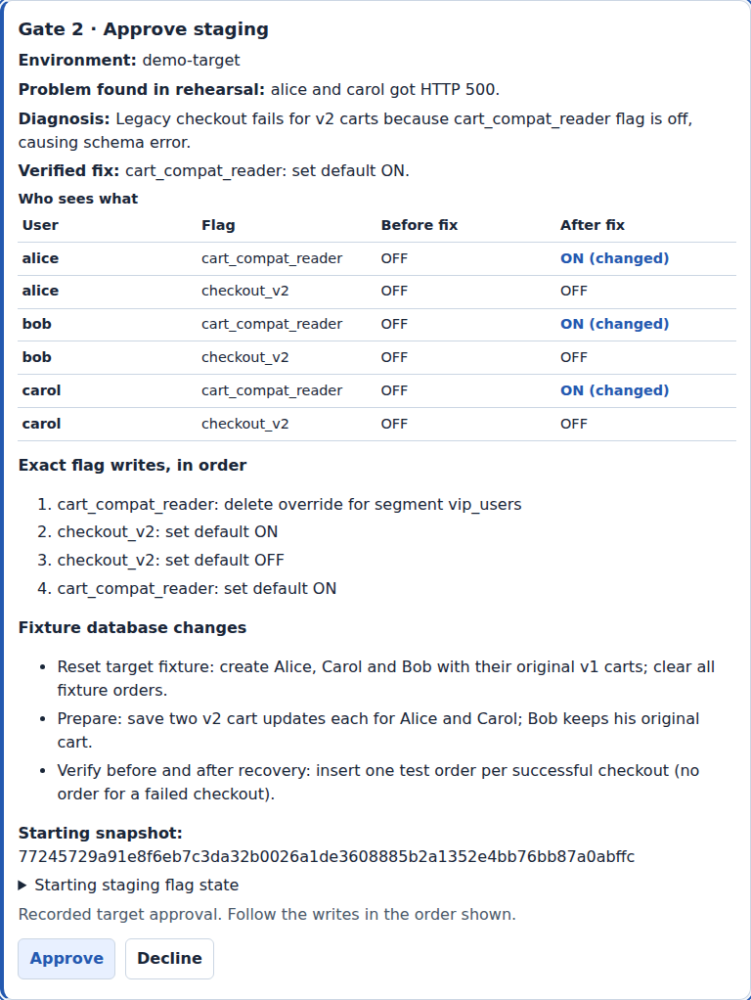

# Rewind

**Off is not undo.** Rewind rehearses a Flagsmith rollback, checks what breaks, and applies a verified fix to staging after you approve it.

[](https://kittu181707.github.io/rewind/)

## Why I built this
I reproduced two failures in a demo shop: (a) the old version cannot read data the new one saved, so VIP carts get HTTP 500 after rollback; (b) a targeting override keeps some users on the new version even though the default is OFF, with no error.

- “Rehearse the rollback in staging.” ([Flagsmith’s rollback strategy](https://www.flagsmith.com/blog/rollback-strategy))
- “A rollback that touches a database or reopens a fixed bug needs a person…” ([Flagsmith’s automatic rollback guide](https://www.flagsmith.com/blog/automatic-rollback))

## What it does
1. Ask to roll back a feature. Approve switching the flag off in an isolated copy of the shop.
2. Rewind checks what each user sees and whether their latest saved data still works. If something breaks, the agent reads the evidence and proposes a Flagsmith change.
3. A fixed test the agent cannot edit checks up to three fixes. If none passes, staging stays untouched.
4. Approve the exact staging plan. Rewind checks for changed settings, reproduces the failure on staging, applies the fix, and tests again.

| Rewind does on its own | You decide |
| --- | --- |
| Reads evidence, diagnoses failures, and tests possible fixes in the approved rehearsal. | Whether to start the rehearsal and whether to apply the exact staging plan. |
| Stops and reports what changed if staging settings drift or the staging test fails. | Whether to approve a fresh plan or take a separate recovery action. |

## Try it
Open the [browser replay](https://kittu181707.github.io/rewind/) and choose Case A, Case B, or Refusal. These captured runs used real Flagsmith and model calls with scripted approvals. Replay needs no keys and executes nothing. With Python 3.12, run `python -m pip install -e .` and `rewind ui --replay` from the checkout. [](https://codespaces.new/kittu181707/rewind?quickstart=1)

## Run it live
Install Flagsmith CLI v2 and use two dedicated test environments with disposable data. Run `flagsmith login` or set the management key below. Use the [demo config](examples/demo-shop/rewind.config.yaml) and put credentials in your shell or an ignored `.env`.

| Variable | Purpose |
| --- | --- |
| `GROQ_API_KEY` | Groq key for `openai/gpt-oss-120b`. |
| `FLAGSMITH_ENV_KEY_REHEARSAL` | SDK key for `rehearsal`. |
| `FLAGSMITH_ENV_KEY_TARGET` | Separate SDK key for `demo-target` (staging). |
| `FLAGSMITH_API_KEY` | Optional CLI management key, in place of `flagsmith login`. |
| `APP_VARIANT` | Optional. Use `no_compat` for Refusal after seeding `--case refusal`. |

```bash
flagsmith environment list
rewind seed --case a
rewind ui --config examples/demo-shop/rewind.config.yaml
```
Open the launcher file the CLI prints and type `roll back checkout_v2`. Seed changes rehearsal settings only.

**Interactive approval:** The typed `yes` path is covered by tests. Separate human run: _evidence link pending_.

## How it uses Flagsmith
| Feature | What Rewind checks or changes |
| --- | --- |
| Environments | Keeps rehearsal and staging separate, with distinct SDK keys and databases. |
| Identities and traits | Checks which flags each test user actually received. |
| Defaults and segment overrides | Finds settings such as a VIP override that survives a rollback. |
| [CLI and audit log](docs/how-rewind-uses-flagsmith.md) | Runs approved writes with allowlisted arguments and no shell. Check the provider audit log where available. |

## Limits
- A pass covers only the tested journey, users, and fixtures on staging. It does not establish production safety.
- Fixes only change Flagsmith settings. Rewind does not edit app code, change user traits, or undo migrations.
- The checker needs a trusted journey. It supports Boolean flags and equality-based segment rules. Flagsmith Change Requests are not supported.

## Next steps
- Record a run with a person approving both plans.
- Time the same rollback with and without Rewind.
- Test the integration with a second app.

## Docs
[Connect your app](docs/connect-your-app.md) · [Validation and checksums](docs/validation.md) · Sample reports: [Case A](docs/sample-report-case-a.html), [Case B](docs/sample-report-case-b.html), [Refusal](docs/sample-report-refusal.html)
## AI tools used
Author disclosure pending.

[MIT License](LICENSE)
