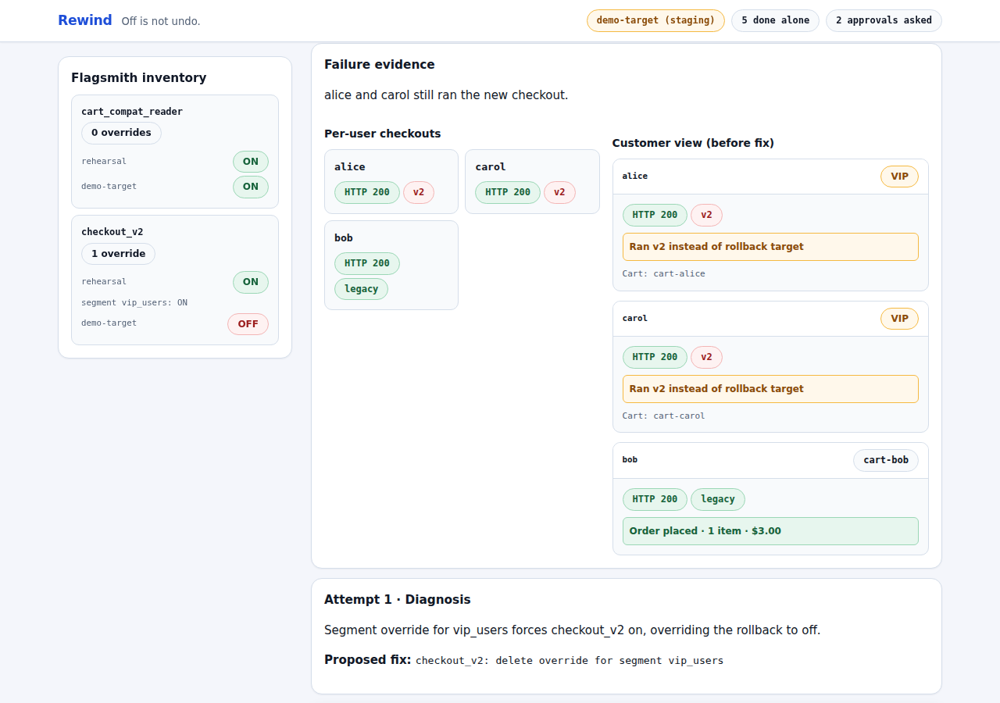
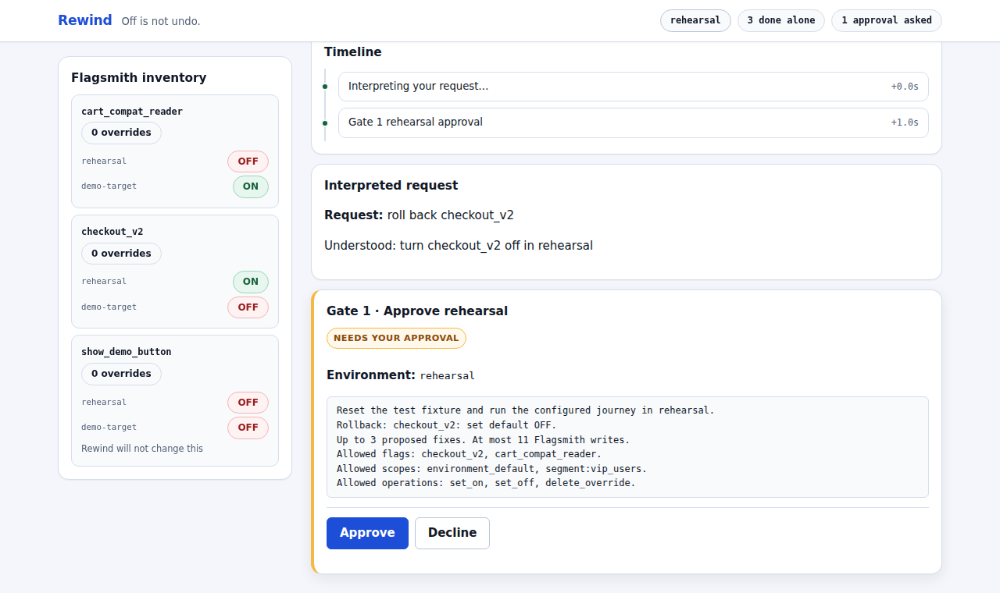

# Rewind

**Off is not undo.** Rewind rehearses a Flagsmith rollback on an isolated copy of your app and asks before applying a verified fix to staging.

**[Try the browser replay](https://kittu181707.github.io/rewind/)** (no account or keys) · [See the Case B report](docs/sample-report-case-b.html)

[](https://kittu181707.github.io/rewind/)

Every checkout returned HTTP 200, but Alice and Carol still got the new checkout. In this captured run, Rewind traced the difference to a VIP override that kept the flag on for them.
## Why I built this
I reproduced two failures in a demo shop: (a) the old version cannot read data the new one saved, so VIP carts get HTTP 500 after rollback; (b) a targeting override keeps some users on the new version even though the default is OFF, with no error.


*After a plain rollback, Alice's saved v2 cart fails on the old checkout.*

- “Rehearse the rollback in staging.” ([Flagsmith’s rollback strategy](https://www.flagsmith.com/blog/rollback-strategy))
- “A rollback that touches a database or reopens a fixed bug needs a person…” ([Flagsmith’s automatic rollback guide](https://www.flagsmith.com/blog/automatic-rollback))

## What it does
1. Approve a rehearsal. Rewind saves test data, then switches the flag off in isolation.
2. See what each user got after the change. If a check fails, the agent reads the evidence and proposes a Flagsmith setting change.
3. Rewind tests up to three fixes against the same users and data. The agent cannot edit those tests. If none passes, staging stays untouched.
4. Approve the exact staging writes. Rewind checks that staging still matches the approved starting state, then reproduces the failure, applies the fix, and tests again.

| Rewind does on its own | You decide |
| --- | --- |
| Reads evidence, tests fixes in rehearsal, and reports unexpected changes or failures on staging. | Whether to approve rehearsal, the exact staging plan, or a separate recovery action. |



*Approval 1: rehearse in this environment, with these allowed changes*


*Approval 2: apply these exact changes to staging*

## Try it
Pick **Case A** for an HTTP 500 on saved carts, **Case B** for the silent VIP override, or **Refusal** to see staging stay untouched. These are captured runs with real Flagsmith and model calls and scripted approvals. Replay executes nothing.
From the checkout with Python 3.12, run `python -m pip install -e .` then `rewind ui --replay`. [](https://codespaces.new/kittu181707/rewind?quickstart=1)

## Run it live
Install Flagsmith CLI v2 and use two dedicated test environments with disposable data. Run `flagsmith login` or set the management key below. Use the [demo config](examples/demo-shop/rewind.config.yaml) and put credentials in your shell or an ignored `.env`.

| Variable | Purpose |
| --- | --- |
| `GROQ_API_KEY` | Groq key for `openai/gpt-oss-120b`. |
| `FLAGSMITH_ENV_KEY_REHEARSAL` | SDK key for `rehearsal`. |
| `FLAGSMITH_ENV_KEY_TARGET` | Separate SDK key for `demo-target` (staging). |
| `FLAGSMITH_API_KEY` | Optional CLI management key, in place of `flagsmith login`. |
| `APP_VARIANT` | Optional. Use `no_compat` for Refusal after seeding `--case refusal`. |
```bash
flagsmith environment list
rewind seed --case a
rewind ui --config examples/demo-shop/rewind.config.yaml
```
Open the launcher file and enter `roll back checkout_v2`. Seed changes rehearsal settings only.
**Interactive approval:** The typed `yes` path is covered by tests. Separate human run: _evidence link pending_.

## How it uses Flagsmith
| Feature | What Rewind checks or changes |
| --- | --- |
| Environments | Keeps rehearsal and staging separate, with distinct SDK keys and databases. |
| Identities and traits | Checks which flags each test user actually received. |
| Defaults and segment overrides | Finds settings such as a VIP override that survives a rollback. |
| [CLI and audit log](docs/how-rewind-uses-flagsmith.md) | Runs approved writes with allowlisted arguments and no shell. Check the provider audit log where available. |

[MIT License](LICENSE)
